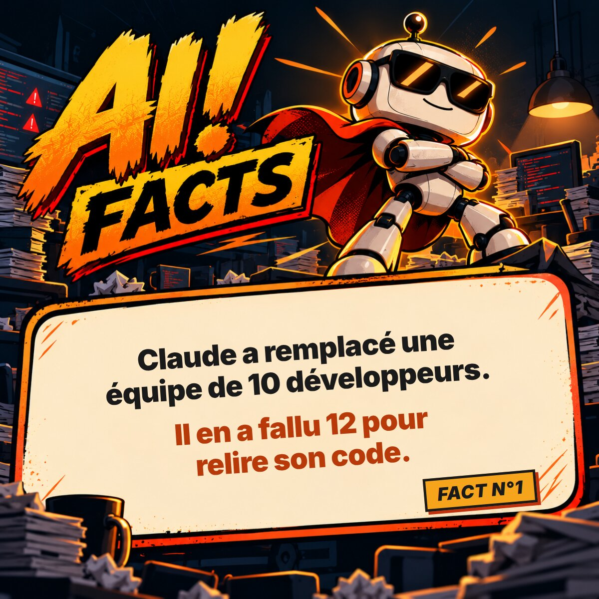

# AI! FACTS

> L'IA sait tout faire. Il paraît. Comme Chuck Norris en son temps, elle méritait ses facts.

🌐 **[aifacts.fr](https://aifacts.fr)** · 🤖 un nouveau fact chaque vendredi · 🙌 **[proposer un fact](CONTRIBUTING.md)**

## Proposer un fact

Les Chuck Norris Facts sont devenus cultes grâce à leurs contributeurs. Ici, c'est pareil :

- **Le plus simple** : le formulaire sur [aifacts.fr](https://aifacts.fr).
- **Sans quitter GitHub** : ouvre une [issue « Nouveau fact »](../../issues/new?template=nouveau-fact.yml).
- **Avec Git** : ajoute ton fact dans [`facts/facts.json`](facts/facts.json) et ouvre une pull request.

Toutes les règles sont dans [CONTRIBUTING.md](CONTRIBUTING.md). Les meilleurs facts sont publiés le vendredi, avec le nom de leur auteur.

## Licences

- **Code** : [MIT](LICENSE)
- **Facts et visuels** : [CC BY 4.0](https://creativecommons.org/licenses/by/4.0/deed.fr). Réutilisation libre, en citant « AI! FACTS – aifacts.fr ».
